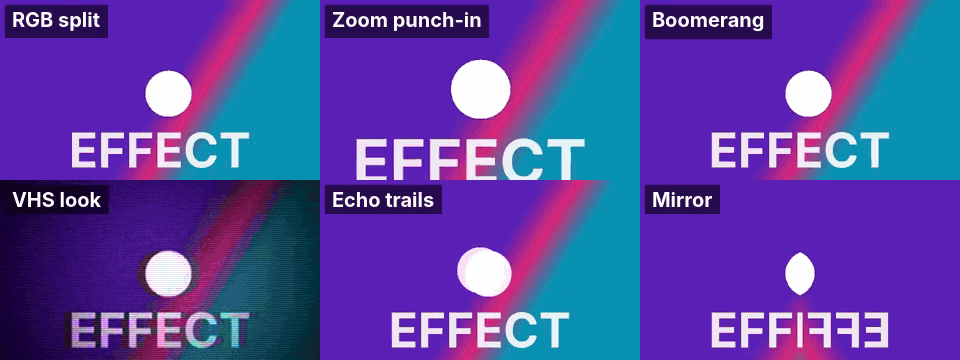
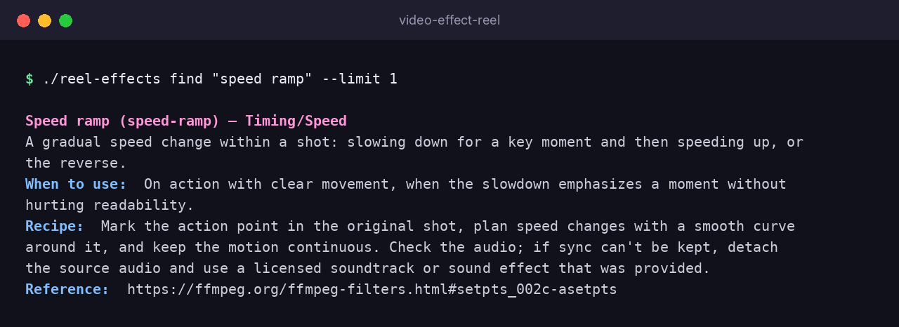
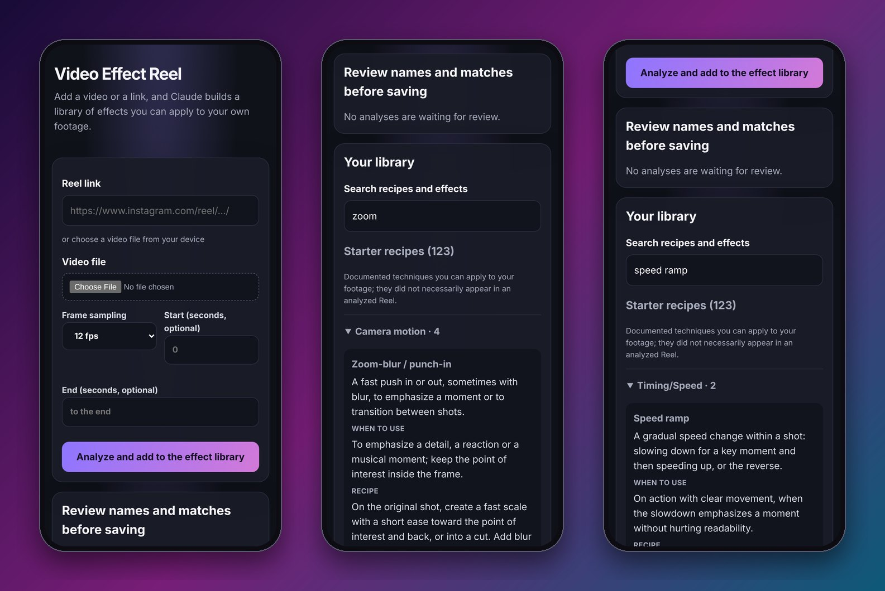

<div align="center">

# 🎬 Video Effect Reel

**See a Reel with an editing trick you love? Find out what it is, and recreate it on your own footage.**

Drop in a link or a video. Claude Code reads it frame by frame, names the effects, and writes a recipe for each one.
You also get **123 ready-made effect recipes** out of the box.

[](https://github.com/moshspro-dev/video-effect-reel/actions/workflows/check.yml)
[](LICENSE)


[Quick start](#-quick-start) · [Effects](#-123-effects-and-counting) · [Use it from your editing agent](#-plug-it-into-your-editing-agent) · [Contribute](#-add-an-effect-in-5-minutes)



<sub>Six recipes from the library, rendered with FFmpeg on a synthetic test clip. Each one is a real entry you can look up with <code>./reel-effects find</code>.</sub>

</div>

---

## ✨ Why this exists

- You watch a Reel and think *"how did they do that transition?"* but you don't know its name, let alone how to build it.
- Tutorials are long, and effect names differ between tools.
- So: give the video to Claude Code, get **timestamps, a description, visual evidence and a practical recipe**, and keep every analysis in a searchable library that grows with you.

It is a **reference library, not a renderer**. Your own editing tool (HyperFrames, Remotion, FFmpeg, After Effects…) does the rendering; this project tells it *what* to build and *how*.

## 🚀 Quick start

```bash
git clone https://github.com/moshspro-dev/video-effect-reel.git
cd video-effect-reel

./reel-effects find "speed ramp"            # works right away, standard library only
./setup.sh                                  # one-time: Pillow + yt-dlp for video analysis
./reel-effects add ~/Videos/reference.mp4   # analyze a video (needs FFmpeg + Claude Code)
.venv/bin/python web_server.py              # phone-friendly page at http://127.0.0.1:4319/
```

<div align="center">

</div>

`find` searches names, aliases, tags and recipes, plus your own analyses. Add `--json` for scripts and agents.

## 📱 A page you can use from your phone

Paste a Reel link or upload a clip, review the effect names Claude suggests, and save them to your private library.

<div align="center">

</div>

## 🧰 123 effects and counting

| Category | # | A few examples |
|---|---:|---|
| Transitions | 33 | Whip pan, match cut, smash cut, spin, iris, crosszoom, cube rotate |
| Texture / stylize | 19 | VHS look, datamosh, halftone, film grain, scanlines, sketch/comic |
| Color / exposure | 16 | Duotone, LUT look, hue shift, negative flash, selective monochrome |
| Transform / distort | 12 | Kaleidoscope, shatter, fisheye, barrel, corner pin |
| Blur / glow | 10 | Echo trails, motion blur, progressive blur, glow halo |
| Timing / speed | 8 | Speed ramp, boomerang, reverse, optical-flow slow motion, stutter |
| Camera motion | 7 | Dolly zoom, Ken Burns, rack focus, handheld drift, shake on impact |
| Reveal / mask | 5 | Letterbox bars, before/after slider, tear reveal |
| Compositing | 5 | Split screen, picture-in-picture, text behind subject, clone |
| Text and emphasis | 6 | Word-by-word captions, kinetic text, typewriter, sticker cutout |
| Other | 2 | Light leak, RGB split |

Every recipe says what you see, when to use it, and how to recreate it on your own footage. Several include FFmpeg commands that were test-run. Browse them all in [`library/EFFECTS.md`](library/EFFECTS.md).

## 🔌 Plug it into your editing agent

Give your editing skill or agent one line and it will look recipes up instead of improvising:

```bash
/path/to/video-effect-reel/reel-effects find "whip pan"
```

A ready-to-paste section for Claude Code skills and `CLAUDE.md` files is in [`integrations/editing-skill-snippet.md`](integrations/editing-skill-snippet.md). The library also includes a Claude Code skill, `/reel-effect-librarian`, for planning edits interactively.

## 🔒 Private by design

- The shared library (`library/`) contains **only general recipes**, never someone's videos.
- **Your analyses and the links you analyzed stay in `local/`**, which Git ignores. You can pull updates and send contributions without publishing anything you studied.
- Nothing is published by this tool. Video frames go only to the Claude Code account you already use.

## 🤝 Add an effect in 5 minutes

Know a technique that's missing? Add one entry to `library/effects.json`, run `./reel-effects index && ./reel-effects check`, and open a pull request. A CI check validates every PR. The entry format and a checklist are in [CONTRIBUTING.md](CONTRIBUTING.md).

## ⚙️ How it works

1. FFmpeg samples the video at 12–30 fps and builds timestamped contact sheets (`--start`/`--end` limit the range).
2. Claude Code, in non-interactive read-only mode, studies the sheets together with the library and returns effects with start/end time, evidence frames, confidence and a recipe. It also flags matches with recipes you already have.
3. You review and rename the effects, then they are saved to your private `local/` folder.

The starter pack is based on the documented Remotion transitions and effects and on FFmpeg's built-in filters. These entries are **general techniques, not claims that a specific Reel used them**. Only your own analyses describe what was seen in a video.

## 📋 Requirements

- Python 3.10+ (`find`, `check` and `index` need nothing else)
- For analyzing videos: FFmpeg, [Claude Code](https://claude.com/claude-code) signed in (`claude auth status`), plus the packages from `./setup.sh` (Pillow, yt-dlp)
- macOS or Linux (Windows via WSL)

## 🛠️ Everyday commands

```bash
./reel-effects add 'https://www.instagram.com/reel/…/'            # needs yt-dlp; see below if login is required
./reel-effects add --start 4 --end 7 --fps 30 ~/Videos/clip.mp4   # a short, fast section
./reel-effects find zoom                                          # search recipes and your analyses
./reel-effects list                                               # print the whole library
./reel-effects check                                              # validate the library
```

If Instagram needs a logged-in session, add `--cookies-from-browser chrome` only for a browser profile that is already logged in, or just save the video and pass its path.

Your analyses live in `local/`. Set `REEL_EFFECTS_LOCAL_DIR` to a synced folder if you want the same analyses on two computers.

### Run the page in the background

Copy `deploy/video-effect-reel.service` to `~/.config/systemd/user/`, edit the lines marked `EDIT`, then `systemctl --user enable --now video-effect-reel`. To open the page to your phone on the same Wi-Fi, set `REEL_EFFECTS_HOST=<your LAN IP>`.

> **Security:** the page has no login. Anyone who can reach it can run Claude Code on your account and read your library. Keep it on `127.0.0.1` or a private home network, and **never expose it to the internet**.

## ⚖️ Notes

- Frame sampling catches fast changes better than a single thumbnail, but even 30 fps can miss sub-frame effects. Reports separate visible evidence from inference.
- Only process videos you have the right to analyze, and follow each platform's terms. Recipes are meant for **your own footage**; don't reuse other people's footage, music or assets.
- Licensed under [MIT](LICENSE). Contributions welcome. If this saved you time, a ⭐ helps others find it.
